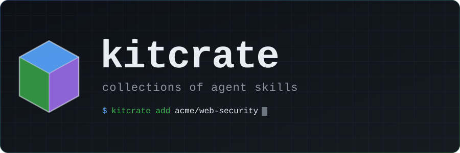

<p align="center">
  
</p>

<p align="center">
  <a href="https://github.com/matthew-eth724/kitcrate/blob/main/LICENSE"></a>
</p>

<p align="center">
  
  
  
  
  
</p>

The `skills` CLI installs individual skills but has no notion of a *collection*. kitcrate adds one: author a collection, publish it to GitHub, install the whole set into a project with one command, and keep it updated as the collection grows.

Git is the backend — no server, no registry. GitHub access goes through the `gh` CLI, never a custom OAuth flow.

```
kitcrate add acme/web-security     # install a whole collection
kitcrate list                      # what's installed, and where each skill came from
kitcrate update                    # pull the latest from every collection
kitcrate create                    # publish a brand-new collection
kitcrate publish                   # push a change to a collection that already exists
```

---

## Installation

From npm:

```sh
npm install -g kitcrate
# or
pnpm add -g kitcrate
```

Requires Node `>=22.20.0` and the [`gh` CLI](https://cli.github.com/) authenticated against GitHub:

```sh
gh auth status
```

---

## Concepts

- **Skill** — a folder with a `SKILL.md` (frontmatter: `name`, `description`). The atomic unit the `skills` CLI installs, for one or more agents (75+ agents supported).

- **Collection** — a git repository (or a subfolder) with a `collection.json` at its root. One collection is one repository by default. A collection **lists** the skills it offers; the skills themselves may live in *other* repositories.

- **Manifest** (`collection.json`) — written by the author. It says what the collection offers and where each member skill comes from:

  ```json
  {
    "name": "web-security",
    "version": "1.2.0",
    "description": "Web app security review skills",
    "skills": [
      { "source": ".",                       "skill": "web-recon"   },
      { "source": "acme/web-security",       "skill": "xss-review"  },
      { "source": "other/shared-skills",     "skill": "burp-notes", "ref": "v2" }
    ]
  }
  ```

  - `source: "."` — the skill lives in this collection's own repository.
  - `source: "owner/repo"` — the skill lives in *that* repository and is installed from there, at that entry's optional `ref`.
  - A collection may span many repositories, and members sharing a source and ref are installed together in one `skills` call.

- **Lockfile** (`kitcrate-lock.json`) — written by kitcrate in the *consumer's* project, committed, never hand-edited. It records which collections are installed, at what version, and which skills belong to each. Only `add`, `install`, `update`, and `remove` write it; the publisher never does.

- **Install scope** — each collection is installed either **into the project** (`<project>/.agents/skills`, the default) or **globally** (`~/.agents/skills`, shared across every project on the machine). The choice is recorded per collection in the lockfile, and every later command follows it.

---

## Commands

### `kitcrate add <source>`

Fetch `collection.json`, install its member skills, and record the collection in `kitcrate-lock.json`.

```sh
kitcrate add acme/web-security
kitcrate add github:acme/web-security@v1.2.0
kitcrate add acme/web-security --global     # install globally, no prompt
```

- Asks whether to install into the project or globally (`--yes`, `--json`, `--global`, or a non-TTY run skips the prompt and assumes the project).
- Each member skill is installed from the source its own manifest entry names, at that entry's ref.

### `kitcrate install`

Restore every collection from `kitcrate-lock.json` into the scope each one was installed at, verifying each `manifestHash`. Re-runs cleanly after a fresh clone of the project.

```sh
kitcrate install
```

### `kitcrate update [name]`

Re-resolve each collection's ref and diff the new manifest against the locked one, adding, removing, or bumping member skills, then rewrite the lockfile.

```sh
kitcrate update          # every collection
kitcrate update web-security
```

- New members are installed from their own source; removed members are removed (respecting ownership rules).
- Destructive changes need `--yes` to proceed.

### `kitcrate remove <name>`

Remove a collection from the lockfile and delete **only the skills kitcrate installed itself**.

```sh
kitcrate remove web-security
```

- Never deletes a skill that was already present when the collection was added, or that another collection claims.
- If a skill's `skills-lock.json` entry no longer matches what kitcrate installed (for example you later ran `skills add` on it), it is left in place and reported.

### `kitcrate list`

One entry per installed (collection, skill) pair: the skill and where it is installed, the agents it is installed for, the collection that brought it, and the skill's own source.

```
account-activity ~/abc/.agents/skills/account-activity

Agents: Claude Code, Codex, fx, Gemini CLI, GitHub Copilot +2 more

Collection: matt711/mywebskills

Source: acme/webtools
```

- `Collection:` and `Source:` are shown as `owner/repo`. `Source` is the skill's **original** repository, read from the `skills` lock file — not the collection's.
- Coloured on a terminal, plain when piped. `--json` gives a machine-readable view with the raw sources.

### `kitcrate validate [path]`

Check a `collection.json` and the skills it references, reporting every problem found.

```sh
kitcrate validate            # ./collection.json
kitcrate validate path/to/collection.json
```

### `kitcrate create [path]`

Publish a brand-new collection. It discovers the skills in a directory, prompts for the collection's details, writes `collection.json` and a `.gitignore`, commits, tags `v0.1.0`, and creates the GitHub repository.

```sh
kitcrate create                          # interactive
kitcrate create path/to/skills --yes     # take every skill, publish private
```

- Discovers skills with the `skills` CLI's own discovery, so nested `.agents/skills/<name>/SKILL.md` folders are found.
- Prompts for name, description, and visibility (private by default; public needs explicit confirmation), then a skill picker — **space toggles, enter finalises, nothing pre-ticked**.
- Each member's own `owner/repo` is recorded in the manifest, read from the lock file the `skills` CLI wrote when you installed the skill. A skill kitcrate can't attribute records `.` and installs from the collection itself.
- Credential files (`.env`, `.env.*`, `.netrc`, `.npmrc`, …) are unstaged so they stay on disk but are **never pushed**; `.env.example` is publishable. Secret *findings* are reported but never block a publish.
- Stages only `collection.json`, `.gitignore`, and the selected skill folders — never `git add .`.
- Picks a free remote name (`origin`, else `github`) and never renames your remotes.
- Retryable: an index that already matches HEAD skips the commit, and a `v0.1.0` tag kitcrate made moves to the new commit.

### `kitcrate publish [name]`

Publish a **change to a collection that already exists**. It asks which collection, lists the skills it doesn't have yet, and copies the chosen ones — plus any local changes to members it already carries — into the collection's repository.

```sh
kitcrate publish                       # pick the collection interactively
kitcrate publish web-security --yes    # add every new skill, publish private
```

- **Candidates** are every collection in the project's `kitcrate-lock.json` (labelled with its scope) plus every repository among the globally installed skills.
- Clones the collection's repository into a temporary directory — **your working tree is never written to**.
- A picked skill is copied in and recorded as a `.` member, so consumers install it from the collection's repository.
- **Only a `.` member is updated from the local copy.** A member whose source is another repository is installed from there, so a difference in its folder is reported rather than copied.
- Rewrites `collection.json`, bumps the patch version, commits as `chore: collection <name> v<version>`, tags `v<version>`, and pushes.
- `gh api repos/{owner}/{repo} --jq .permissions.push` decides where it goes: with push access, the collection's own repository is updated; without it, a new private repository is created under your own account.
- Nothing to publish is not a release — no version is raised and nothing is pushed.

---

## Options

Every command accepts these global flags:

| Flag | Meaning |
|---|---|
| `--yes` | Non-interactive. On `add`: don't ask where to install. On `update`/`remove`/`publish`: go ahead. |
| `--json` | Machine-readable output; also suppresses the spinner and colour. |
| `--global` | `add` only: install into `~/.agents/skills` instead of the project. |
| `--debug` | Include stack traces on errors. |
| `--allow-secrets` | Accepted and ignored — secret findings never block a publish. |
| `--help` / `-h` | Command-specific help. |

Run `kitcrate <command> --help` for command-specific usage.

---

## Example: a full lifecycle

**Author:** gather skills, then publish a collection.

```sh
# install some skills the way you normally would
skills add acme/web-recon
skills add aave/account-activity

# publish a collection of them
cd ~/my-skills
kitcrate create
# pick a name, description, and the skills to include
# -> creates github:<you>/my-skills, tags v0.1.0

# later, add a new skill and push the change
cd ~/my-skills
kitcrate publish
# tick the new skill -> collection bumps to v0.1.1, pushed
```

**Consumer:** install and update.

```sh
# in your project
kitcrate add github:<you>/my-skills
kitcrate list                     # see the skills and where they came from

# when the author publishes a new version
kitcrate update
```

---

## How it fits together

- **kitcrate owns `kitcrate-lock.json`.** Only `add`, `install`, `update`, and `remove` write it.
- **`skills` owns `skills-lock.json`.** kitcrate never writes it directly; it goes through the `skills` public API (`resolveSource`, `installSkills`, `listSkills`, `removeSkills`), and all `skills` imports are isolated in `src/skills/`.
- **The publisher never creates a lockfile.** Publishing only ever edits a collection's own repository.
- **Ownership rules.** kitcrate removes only the skills it installed itself — never a preexisting skill, never a skill claimed by another collection, never a direct install a collection doesn't list.
- **Secrets never travel.** Credential files are excluded from every publish; secret findings are reported, not blocking.

---

## Development

```sh
pnpm install
pnpm typecheck     # tsc --noEmit for src and test
pnpm lint          # prettier --check
pnpm test          # vitest
pnpm build         # tsc -> dist/
```

`./init.sh` runs typecheck, lint, and tests in one pass. Tests are unit tests for the core modules plus integration tests that use local bare git repositories as fake remotes and a `gh` stub on `PATH` — they never hit the network or GitHub.

---

## License

MIT